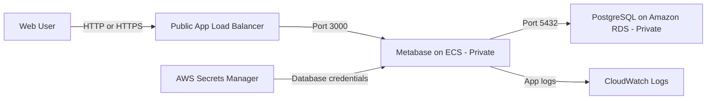

# Metabase on AWS with Terraform

This project provisions a web-accessible Metabase app on AWS using Terraform

the assignment requirements by providing Terraform IaC, a web entry, a private PostgreSQL database, and secure secret management. Only the External ALB is public access. ECS tasks have no public IP, RDS is also private, and the database password is generated by RDS then stored in AWS Secrets Manager, and applied to the Metabase container at runtime

## Simple Architecture

Users access Metabase through a public Load Balancer. Metabase and PostgreSQL run inside private networks and cannot be accessed directly from the internet.



## project heirachy

```text
[CRL] metabase-terraform-aws/
├── environments/
│   ├── dev-common-config.json
│   └── prd-common-config.json
├── modules/
│   ├── network/
│   ├── security/
│   ├── alb/
│   ├── rds-postgresql/
│   └── ecs-metabase/
├── main.tf
├── variables.tf
├── outputs.tf
├── providers.tf
└── versions.tf
```

## Prerequisites

- An AWS account with a valid payment method
- An AWS Budget and billing alerts configured (recommended)
- Terraform `1.10` or later
- An IAM Identity user assigned `AdministratorAccess` permission set (If Terraform runs from Jenkins, use dedicated IAM role for the Jenkins Identity)
- Do not use the AWS root account to run Terraform

Configure and authenticate the AWS CLI:

```powershell
aws configure sso --profile metabase-dev
aws sso login --profile metabase-dev
$env:AWS_PROFILE = "metabase-dev"

aws sts get-caller-identity
aws configure get region --profile metabase-dev
```

For this lab, the `AdministratorAccess` permission set can be used. It grants full access to the selected AWS account and should not be used as the normal permission model for prod.

Review `environments/dev-common-config.json` especially:

- AWS Region and Availability Zones
- VPC and subnet CIDRs
- `allowed_cidr_blocks`
- Metabase CPU, memory, image, and task count
- RDS instance class, storage, backups, and deletion settings
- Certificate if HTTPS is required

For production, do not leave the ALB(External) to `0.0.0.0/0` unless public access is intentional, Configure HTTPS before using sensitive data.

## Steps

Run these commands from the project directory.

### 1. Initialize Terraform

```powershell
terraform init
```
### 2. Check format

```powershell
terraform fmt -check -recursive
```
### 3. Validate the configuration

```powershell
terraform validate
```
### 4. Create and save the development plan

```powershell
terraform plan `
  -var-file=environments/dev-common-config.json `
  -out=dev.tfplan
```

The current plan shows:

```text
Plan: 48 to add, 0 to change, 0 to destroy.
Changes to Outputs:
  + alb_dns_name               = (known after apply)
  + ecs_cluster_name           = "metabase-dev-cluster"
  + ecs_service_name           = "metabase-dev-metabase"
  + metabase_url               = (known after apply)
  + rds_endpoint               = (known after apply)
  + rds_master_user_secret_arn = (sensitive value)
  + rds_publicly_accessible    = false
  + vpc_id                     = (known after apply)
```

### 5. Apply the reviewed plan

```powershell
terraform apply dev.tfplan
```

Do not run `terraform apply` until AWS billing and access have been configured

## Test the deployment

### 1. Display the deployment outputs

```powershell
terraform output
```

Important outputs include the Metabase URL, ALB DNS name, ECS cluster and service names, private RDS endpoint, and VPC ID.

### 2. Test the Metabase health

```powershell
$METABASE_URL = terraform output -raw metabase_url
Invoke-RestMethod "$METABASE_URL/api/health"
```

Expected result: HTTP `200` with a healthy response.

If PowerShell has a certificate or response-format issue, use:

```powershell
curl.exe -i "$METABASE_URL/api/health"
```

### 3. Open Metabase in a browser

```powershell
Start-Process $METABASE_URL
```

Expected result: the Metabase setup page or login page open

### 4. Confirm that RDS is private

```powershell
terraform output rds_publicly_accessible
```

Expected result:

```text
false
```

(Optional) AWS CLI:

```powershell
aws rds describe-db-instances `
  --query "DBInstances[?contains(DBInstanceIdentifier, 'metabase')].{ID:DBInstanceIdentifier,Public:PubliclyAccessible,Endpoint:Endpoint.Address}" `
  --output table
```

### 5. Confirm that the ECS task is running

```powershell
$CLUSTER = terraform output -raw ecs_cluster_name
$SERVICE = terraform output -raw ecs_service_name

aws ecs describe-services `
  --cluster $CLUSTER `
  --services $SERVICE `
  --query "services[0].{Status:status,Desired:desiredCount,Running:runningCount,Events:events[0:5]}" `
  --output json
```

Expected result: service status `ACTIVE` and `runningCount` equal to `desiredCount`.

### 6. Check Metabase logs

```powershell
aws logs tail "/ecs/metabase-dev/metabase" --follow
```

Look for a successful Metabase startup task

## Activities checklist

- `terraform fmt -check -recursive` passes
- `terraform validate` passes
- `terraform plan` passes 
- Metabase health endpoint = HTTP `200`
- Metabase setup or login page opens through the ALB IP
- ECS running task count equals the desired task count
- `rds_publicly_accessible` returns `Public:false`
- PostgreSQL port `5432` is allowed only from the Metabase security group
- No password or AWS credential exists in the repository or tfvars files

## Destroy the dev environment

Destroy the lab when it is no longer needed to stop ongoing charges:

```powershell
terraform plan `
  -destroy `
  -var-file=environments/dev-common-config.json `
  -out=dev-destroy.tfplan

terraform apply dev-destroy.tfplan
```
